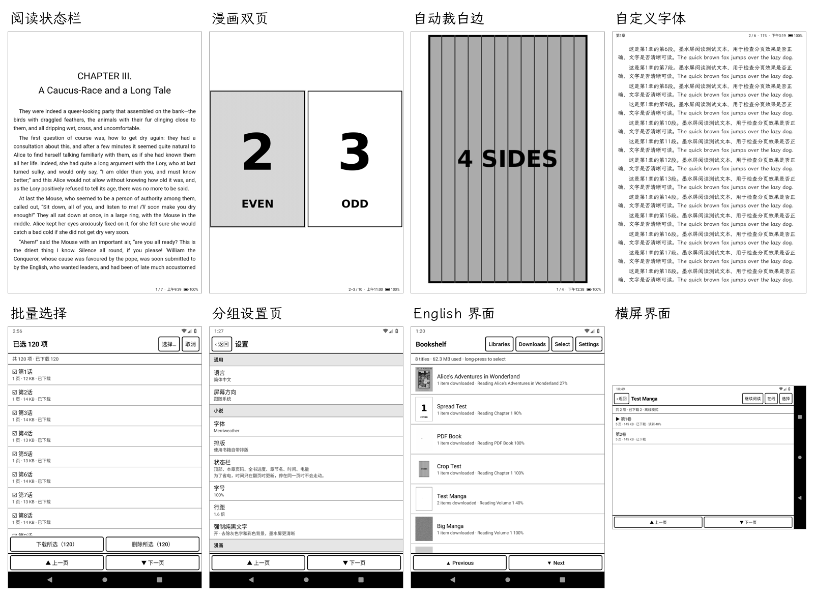
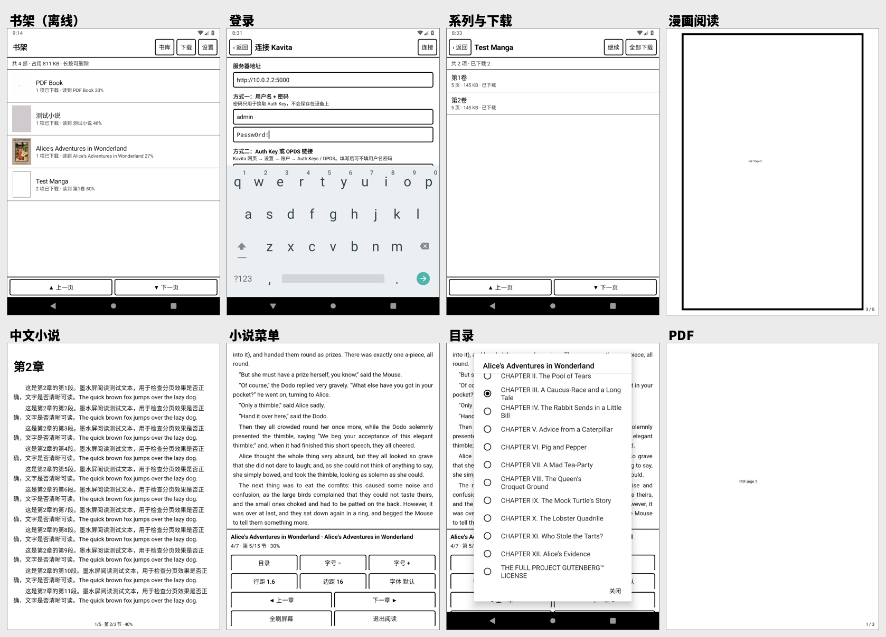
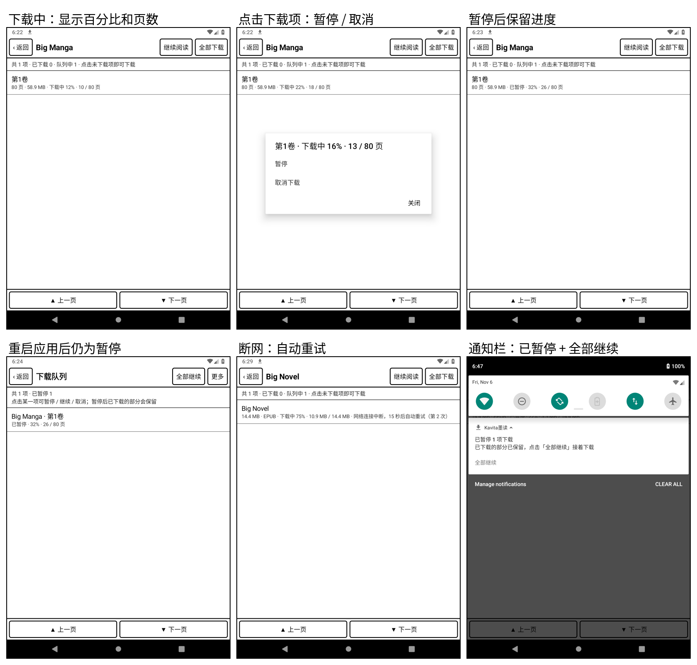

# KavitaInk

[](https://github.com/yunyuyuan/KavitaInk/actions/workflows/build.yml)
[](https://github.com/yunyuyuan/KavitaInk/releases/latest)

一个**专为墨水屏设计**的极简 [Kavita](https://www.kavitareader.com/) 安卓客户端。只做三件事：**浏览书库 → 下载到本地 → 离线阅读**（漫画 + 小说）。不同步进度、不做后台任务、没有动画。

| 项目 | 说明 |
| --- | --- |
| 安装包 | Release 约 120 KB，零第三方依赖 |
| 系统要求 | Android 5.0 及以上（minSdk 21），面向安卓墨水屏阅读器（已在 Android 9 + 老版 WebView 66 模拟器上实测，尚未在实体墨水屏设备上测试） |
| 服务器 | Kavita v0.9 系列（已在 v0.9.1.4 上实测）。依赖 v0.9 引入的 Auth Key 认证，v0.8 及更早版本不保证可用 |
| 支持格式 | 漫画：cbz（已实测）；cbr / cb7 / zip / rar / 7z / 图片文件夹由服务器解压，理论上同样支持；小说：EPUB；文档：PDF |

## 功能

**书架（离线）**：打开应用只扫描本地目录，**不产生任何网络请求**。按最近阅读排序，显示每部作品的下载数量和读到哪里。长按进入多选，可批量删除，并显示释放了多少空间。

**书库（在线）**：浏览各书库、按名称搜索、分页加载（每页 50 个，点按钮加载下一页，不做无限滚动）。进入系列后可单项下载、「全部下载」，或长按进入多选（全选 / 反选 / 只选未下载 / 只选已下载），再批量下载或删除。

**下载**：前台服务下载，可离开页面、锁屏继续。下载中显示百分比和具体进度（小说 / PDF 显示「3.2 MB / 14.4 MB」，漫画显示「23 / 80 页」）。

- **暂停 / 继续**：在下载队列或系列页点某一项即可暂停、继续或取消；下载队列顶部有「全部暂停 / 全部继续」，通知栏也有「全部暂停」按钮。暂停会**立即断开连接**，已下载的部分全部保留；继续时 EPUB / PDF 用 HTTP Range 从断点续传，漫画从下一页接着下，已有的页不会重复下载。
- **暂停后不耗电**：所有任务都暂停后，下载服务立即停止，并释放唤醒锁和 Wi-Fi 锁。暂停状态会保存下来，应用被杀或重启后**不会自动继续**，需要手动点「继续」。
- **断网自动重试**：遇到断网、超时、服务器 5xx 时，会在 5 秒、15 秒、45 秒后自动重试，每次都从断点继续；认证失败、没有权限、404 这类错误不会重试，而是直接标记为失败。失败的项可以手动「重试」，同样接着下载。
- **取消**：从队列移除并删除未完成的文件。
- **其他**：队列持久化，应用被杀时正在下载的项下次打开会自动继续；会校验文件长度，连接中途被断开时不会把半截文件当成下载完成。

**漫画 / PDF 阅读**：适应屏幕或适应宽度（长图分段翻页）、左→右 / 右→左（日漫）、灰度增强对比度、跳页。

- **双页并排**：可选关闭、横屏时自动或始终开启。可设置页序、中缝间距、分隔线（粗细、颜色）和封面单独显示。宽图（跨页图）自动单独显示；跨页没对齐时可以「错开一页」，按章节记住。错开对每一段连续的竖图都生效（封面之后、每张横图之后各算一段），所以读到哪一段都能马上修正。
- **裁白边**：自动检测并裁掉扫描件四周的白边，可选同时裁黑边。每边最多裁 25%，不会裁进画面。检测直接用已解码的页面像素（按块取平均，相当于最长边不超过 400 px 的缩小图），只读取白边附近的像素（满版画面只看最外侧四条细边就跳过），不会为检测再解码一次；每页只算一次并缓存，翻回来时只解码内容区域。

**EPUB 阅读**：整屏分页（CSS 多栏），目录跳转，字号 / 行距调节，可强制纯黑文字（去掉灰字和彩色背景）。

- **排版**：使用书籍自带排版，或自定义首行缩进、段间距、两端对齐、字间距；左右和上下边距分开调节。自定义时标题、书里居中 / 右对齐的段落和只含图片的段落保持原样，不缩进；字号很大时，长网址这类放不下一行的词会自动断行，不会被截掉。
- **字体**：内置「书籍默认 / 衬线 / 无衬线」三种。也可以从 Kavita 服务器下载字体（含多个字重和斜体变体，支持续传），或导入本机的 TTF / OTF / WOFF / WOFF2 文件。已安装的字体可重命名、删除。

**阅读状态栏**：小说和漫画分别设置，可显示章节内页码、进度、章节名、时间、电量，放在顶部或底部。为了省电，时间和电量**只在翻页时更新**，停在同一页时不会刷新屏幕。

**屏幕方向**：跟随系统 / 竖屏 / 横屏 / 反向竖屏 / 反向横屏，对所有页面生效，阅读菜单里也能快速切换。

**多语言**：English、简体中文、繁體中文、日本語、한국어、Español、Français、Deutsch、Русский、Português (Brasil)。默认跟随系统语言，系统语言不在支持范围内时显示英文；也可以在设置里单独切换（Android 13+ 与系统设置中的「应用语言」同步）。

**检查更新**：只在设置页手动点「检查更新」时访问 GitHub Releases，不做任何后台或定时检查。发现新版本后可以在应用内下载（可取消、可续传），再调用系统安装器安装；安装前会核对包名和签名。

**翻页方式**：点击左 / 右区域、左右滑动、音量键（可交换方向）、实体翻页键 / 方向键。点击屏幕中间或长按呼出菜单。读完一章后再翻一页自动打开下一个已下载的章节。

## 省电与墨水屏设计

| 设计 | 作用 |
| --- | --- |
| 全局关闭窗口动画、转场动画、按钮按压渐变、列表滚动动画 | 每次操作只触发一次屏幕刷新 |
| 列表用「上一页 / 下一页」整屏跳转（音量键同样可用） | 避免滚动产生的连续局部刷新 |
| 翻页 = 视口一次性平移一屏（EPUB）/ 直接替换图片（漫画） | 没有任何中间帧 |
| 没有同步、轮询、推送、定时器、统计 SDK | 阅读时网络完全空闲，可直接开飞行模式 |
| 状态栏的时间、电量只在翻页时重绘，不注册时间 / 电量广播 | 停在一页上时屏幕完全静止 |
| 检查更新只在手动点击时联网 | 没有任何后台网络请求 |
| 唤醒锁和 Wi-Fi 锁只在下载期间持有，完成或全部暂停即释放 | 不在后台偷偷耗电 |
| 下载进度刷新节流（界面 2 秒、通知 2.5 秒一次） | 下载时减少屏幕刷新 |
| 离开阅读器时暂停 WebView 的 JS 定时器 | 防止书内脚本在后台运行 |
| 漫画页按屏幕尺寸降采样解码为 RGB_565，只缓存当前页和下一页 | 降低 CPU 与内存占用 |
| 封面可在设置中关闭 | 浏览书库时减少流量和刷新 |
| 可选「每 N 页黑屏闪一下」做全刷 | 消除残影（默认关闭，交给设备自带的刷新策略） |

## 使用

1. 从 [Releases](https://github.com/yunyuyuan/KavitaInk/releases/latest) 下载最新的 `KavitaInk-x.y.z.apk` 并安装（升级时直接覆盖安装，已下载的内容会保留）。
2. 打开后点右上角「书库」，填写服务器地址（如 `http://192.168.1.10:5000`），然后任选一种方式：
   - **用户名 + 密码**：只用于换取 Auth Key，密码不保存；
   - **Auth Key 或 OPDS 链接**：在 Kavita 网页「设置 → 账户 → Auth Keys / OPDS」复制，直接粘贴整个 OPDS 链接也可以。
3. 进入书库 → 系列 → 点击章节即开始下载（或点「全部下载」）。下载中再点该章节可暂停 / 继续 / 取消；主页「下载」按钮进入下载队列。
4. 下载完成后回到「书架」，即可离线阅读。

> **注意**：Kavita 中该账号需要拥有 **Download** 角色才能下载（管理员默认拥有；普通用户需要在「服务器设置 → 用户」中勾选）。

## 截图







## 技术实现

Kavita API 对接（均在 v0.9.1.4 上实测）：

| 用途 | 接口 | 认证 |
| --- | --- | --- |
| 登录换 Key | `POST /api/Account/login` | 用户名密码 |
| 书库列表 | `GET /api/Library/libraries` | `x-api-key` 请求头 |
| 系列分页 | `POST /api/Series/v2?PageNumber=&PageSize=`（按书库过滤，分页信息在 `Pagination` 响应头） | `x-api-key` |
| 搜索 | `GET /api/Search/search?queryString=` | `x-api-key` |
| 卷 / 章节 | `GET /api/Series/volumes?seriesId=` | `x-api-key` |
| 封面 | `GET /api/Image/series-cover?seriesId=` | `x-api-key` |
| EPUB / PDF 原文件 | `GET /api/Download/chapter?chapterId=`（支持 Range） | `x-api-key`，需 Download 角色 |
| 漫画单页 | `GET /api/Reader/image?chapterId=&page=&apiKey=` | **必须**用 `apiKey` 查询参数 |

为什么漫画按页下载而不是下载压缩包：服务器负责解压 cbr / cb7 / rar，客户端无需内置任何解压库；已下载的页可断点跳过；本地直接是图片，阅读时零解压开销。

EPUB 的处理方式：直接从 zip 中按需读取资源交给 WebView（不解压到磁盘），在章节 HTML 的 `</head>` 前注入分页样式（首帧即为分页效果），再由注入脚本计算页数。翻页用 `transform` 平移整屏，而不是滚动（滚动会被最后一栏的右边界截住导致末页错位，这个问题已在测试中发现并修复）。

针对老版 WebView（很多墨水屏设备没有谷歌商店，WebView 停留在多年前的版本）做了专门适配，均在 Android 9 自带的 WebView 66 上实测：

| 问题 | 现象 | 处理 |
| --- | --- | --- |
| 内容横向溢出时 WebView 自动缩小页面 | 整章排成一栏、文字溢出屏幕底部 | 注入 `viewport` meta 锁定缩放为 1，并以原生端测量的尺寸为准 |
| 高密度屏视口宽度为小数（如 571.73px） | 每翻一页累积 0.73px 偏移 | `html` 宽度固定为整数像素，栏距与平移距离完全一致 |
| 书籍样式中末尾元素带 `page-break-after: always` | 章节末尾多出空白页 | 去掉末尾元素的强制分页，并按最后一段内容的位置裁剪页数 |
| 章节文件缺少 `<head>` | 样式无法注入 | 自动补 `<head>`，脚本端也会兜底注入 |

PDF 的处理方式：使用系统自带的 `PdfRenderer` 渲染；若本机无法打开（加密或损坏），自动改为下载服务器渲染好的页面图片。

离线目录结构（自描述，不依赖数据库，可直接拷贝备份）：

```
Android/data/com.manus.kavitaink/files/library/<服务器>/s<系列ID>/
    series.json  cover
    c<章节ID>/chapter.json        ← 只有下载完成才写入
    c<章节ID>/pages/00000.jpg …   （漫画）
    c<章节ID>/book.epub | book.pdf（小说 / 文档）
```

代码结构：

```
app/src/main/java/com/manus/kavitaink/
  core/      纯 Kotlin，不依赖 Android，可在电脑上直接单元测试
    KavitaApi.kt   接口客户端（HttpURLConnection + org.json）
    Parsers.kt     卷 / 章节解析；Texts.kt 按当前语言生成标题（Volume 1 / 第1卷 / 第3话…）
    Downloader.kt  下载引擎（续传、按页、PDF 回退）
    Storage.kt     离线目录管理
    EpubBook.kt    EPUB 解析（OPF、书脊、EPUB3 nav / EPUB2 NCX 目录）
    Paginator.kt   EPUB 分页 CSS / JS
    Trim.kt        裁白边检测、双页分组
    FontStore.kt   字体库（fonts.json 索引）；KavitaFonts.kt 从 Kavita 下载字体
    Updater.kt     检查更新（GitHub Releases）
  download/  下载队列 + 前台服务
  ui/        书架、登录、书库、系列、下载队列、设置、字体、检查更新
  reader/    阅读器基类、状态栏、漫画 / PDF 阅读器、EPUB 阅读器
  update/    把下载好的安装包交给系统安装器的 ContentProvider
app/src/main/res/values*/strings*.xml   文案：英文（values）和简体中文（values-zh）人工维护，其余语言由 tools/translate.py 生成
```

## 自动构建（GitHub Actions）

[`.github/workflows/build.yml`](.github/workflows/build.yml) 会在以下时机运行单元测试并打包 release APK：

| 触发 | 产物 |
| --- | --- |
| 推送到 `main`、提交 PR、在 Actions 页面手动运行 | APK 作为构建产物上传，在对应运行记录页底部的 **Artifacts** 下载，版本名形如 `1.1.0-abc1234` |
| 推送 `v*` 标签 | 额外创建 GitHub Release，并附上 `KavitaInk-x.y.z.apk` |

**发布新版本**：把 `app/build.gradle.kts` 中的 `baseVersionName` 改成新版本号并提交，然后打标签推送：

```bash
git tag v1.2.0 && git push origin v1.2.0
```

`versionCode` 由版本名自动推算（`1.2.0` → `10200`），无需手动维护。

**签名**：CI 从仓库 Secrets 读取签名密钥，签名密钥本身**不提交到仓库**（`keystore/` 已加入 `.gitignore`）。需要的 Secrets（Settings → Secrets and variables → Actions）：

| Secret | 内容 |
| --- | --- |
| `KEYSTORE_BASE64` | `base64 -w0 release.jks` 的输出 |
| `KEYSTORE_PASSWORD` | 密钥库密码 |
| `KEY_ALIAS` | 密钥别名（`kavitaink`） |
| `KEY_PASSWORD` | 密钥密码（PKCS12 格式与密钥库密码相同） |

没有配置 Secrets 时（例如来自 fork 的 PR），CI 会改用调试签名并给出警告：这样打出的 APK 可以安装，但不能覆盖安装正式签名的版本。**请妥善备份 `release.jks` 和密码**：一旦丢失，就无法再发布能覆盖安装的更新，只能卸载重装（已下载的内容会随卸载一起删除）。

## 本地构建

需要 JDK 17+ 与 Android SDK（platform 35、build-tools 34+）：

```bash
echo "sdk.dir=/path/to/android-sdk" > local.properties
./gradlew assembleRelease          # 输出 app/build/outputs/apk/release/app-release.apk
./gradlew testDebugUnitTest        # 单元测试
```

使用正式签名：把 `release.jks` 放到 `keystore/` 目录，并新建 `keystore/keystore.properties`（这两个文件都不会被提交）：

```properties
storeFile=keystore/release.jks
storePassword=你的密码
keyAlias=kavitaink
keyPassword=你的密码
```

也可以改用环境变量 `KAVITAINK_KEYSTORE`、`KAVITAINK_KEYSTORE_PASSWORD`、`KAVITAINK_KEY_ALIAS`、`KAVITAINK_KEY_PASSWORD`。两者都没有时，release 包使用调试签名。

### 测试

```bash
# 以下测试需要一台 Kavita 测试服务器；模拟器测试通过环境变量 KAVITA_USER / KAVITA_PASS 读取账号

# 连接真实 Kavita 的端到端测试（登录、浏览、三种格式下载、续传、取消、搜索）
KAVITA_URL=http://localhost:5000 KAVITA_USER=admin KAVITA_PASS=xxx ./gradlew testDebugUnitTest

# 暂停 / 续传 / 断网 / 网络卡死测试：先启动限速代理（可模拟断网和网络假死）
python3 tools/throttle_proxy.py 5001 &
KAVITA_PROXY_URL=http://localhost:5001 KAVITA_USER=admin KAVITA_PASS=xxx BIG_EPUB_PATH=<服务器上的原文件> \
  ./gradlew testDebugUnitTest --tests '*PauseResumeLiveTest*'
# 模拟器上的暂停 / 继续 / 重启保持暂停 / 断网自动重试 / 通知栏按钮 / 取消
KAVITA_PASS=xxx python3 tools/e2e_pause.py app/build/outputs/apk/release/app-release.apk

# EPUB 分页在 Chromium 中的验证（需要 playwright）
PAGINATOR_DUMP=/tmp/pdump ./gradlew testDebugUnitTest --tests '*PaginatorDumpTest*'
python3 tools/verify_pagination.py /tmp/pdump /tmp/shots

# 模拟器端到端测试（登录 → 下载三种格式 → 断网 → 离线阅读 → 检查崩溃日志）
KAVITA_PASS=xxx python3 tools/e2e.py app/build/outputs/apk/release/app-release.apk all

# 在设备真实 WebView 中逐页校验分页（需可调试构建：assembleRelease -PrelDebug=true）
python3 tools/verify_webview.py <书.epub> /tmp/pdump <CSS宽|auto> <CSS高|auto>
# F5 排版 × F8 状态栏的各种组合（书籍原排版 / 自定义默认 / 全部最大 / 全部最小 / 状态栏底部全部项），
# 在三本测试书上逐页校验：没有文字被截断、没有空白页、标题 / 居中 / 图片不缩进
python3 tools/verify_layouts.py

# 多语言：资源键和占位符一致、复数类别齐全（CI 也会跑，外加 lint 的 MissingTranslation 检查）
python3 tools/translate.py --check
# 新增或修改了英文文案后，增量翻译其余 8 种语言（需要 OPENAI_API_KEY，结果缓存在 tools/i18n_cache.json）
python3 tools/translate.py

# 1.2.0 新功能的模拟器测试：状态栏、屏幕方向、双页、双页连续翻页内存、裁白边（含耗时）、
# 字体下载 / 导入 / 删除、批量操作、停留 10 分钟无闹钟无刷新、中英文界面截图巡检（V120_ALL_LANGS=1 时巡检全部 10 种语言）
python3 tools/make_fixtures_v120.py <Kavita 漫画库目录>    # 生成测试漫画后在 Kavita 里扫描该库
KAVITA_PASS=xxx python3 tools/e2e_v120.py                  # 也可只跑某几段，如 e2e_v120.py spread crop

# 应用内更新：先用 -PappVersionName=1.1.9 之类的低版本号打一个正式签名包，
# 脚本会安装它，对着 GitHub 上最新的 Release 检查更新、下载、校验签名并通过系统安装器升级
python3 tools/e2e_update.py <低版本号的 apk>
```

## 已知限制

- 竖排（日文直排）EPUB 会被转成横排显示。
- 漫画中的 AVIF 图片需要 Android 12+ 才能解码；JXL 图片 Android 系统目前无法解码（Kavita 默认保留原图格式，JPG / PNG / WebP 不受影响）。
- 跨页大图不会自动拆分；双页模式下会单独显示，单页模式下可切到「适应宽度」查看。
- 包含多个文件的 EPUB 章节暂不支持（极少见）。
- 已下载的内容不会自动跟随服务器更新；需要更新时删除后重新下载即可。
