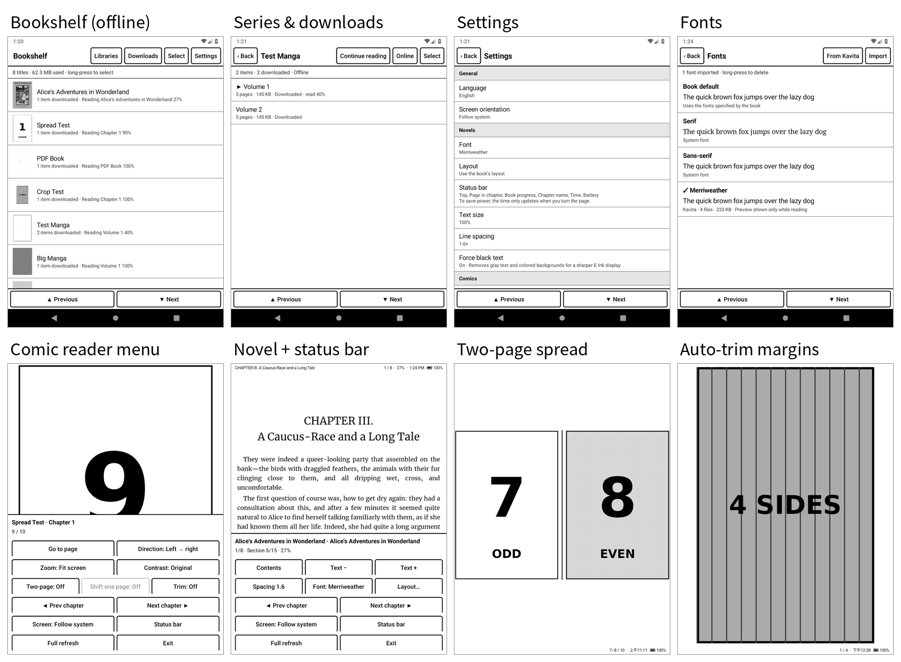
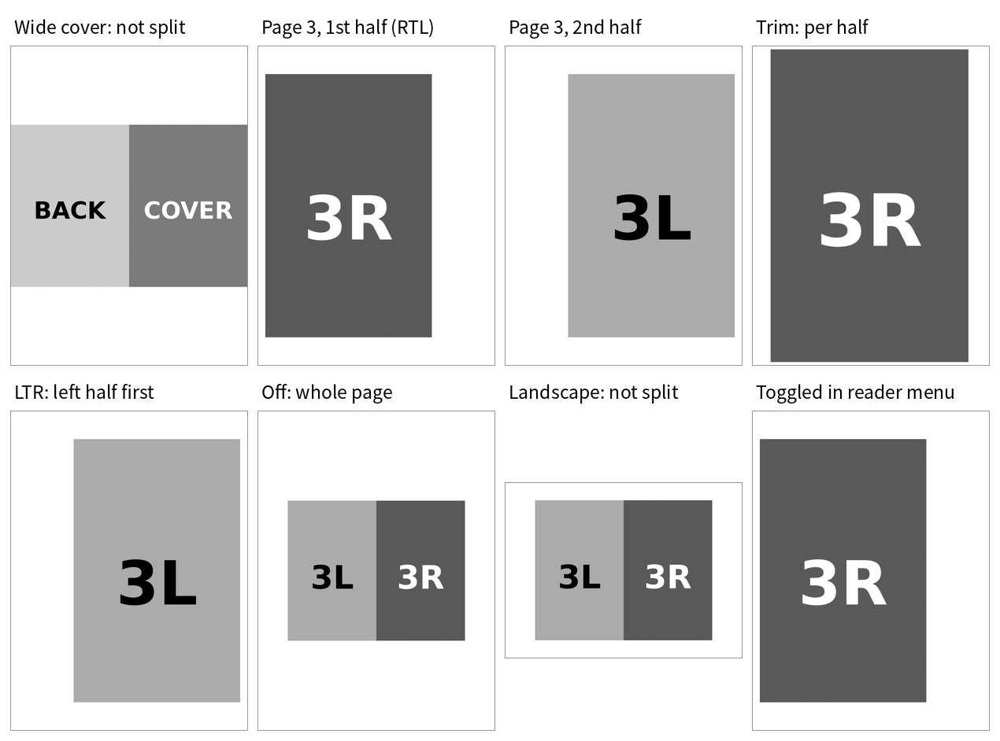
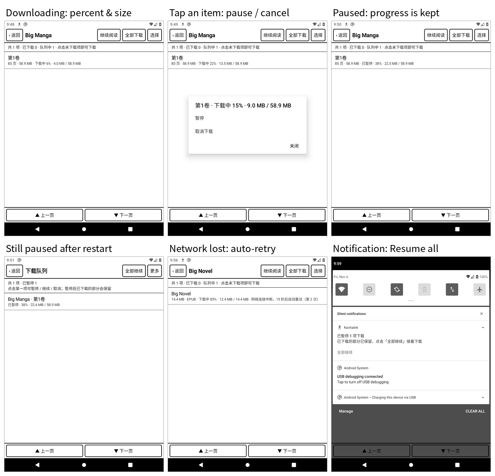

# KavitaInk

English | [简体中文](README.zh-CN.md)

[](https://github.com/yunyuyuan/KavitaInk/actions/workflows/build.yml)
[](https://github.com/yunyuyuan/KavitaInk/releases/latest)

A minimal [Kavita](https://www.kavitareader.com/) client for Android, **designed for E Ink readers**. It does three things: **browse your library → download to the device → read offline** (comics and novels). No progress sync, no background jobs, no animations.

| | |
| --- | --- |
| APK | About 580 KB for the release build (mostly UI strings in 10 languages); no third-party dependencies |
| Requirements | Android 10 or later (minSdk 29), aimed at Android E Ink readers. Tested on an Android 10 emulator; the Android 11+ "All files access" flow follows the platform documentation but has not been tested, because the emulator would not boot. Not yet tested on a physical E Ink device |
| Server | Kavita v0.9 series (tested on v0.9.1.4). Relies on the Auth Key authentication introduced in v0.9; v0.8 and earlier are not guaranteed to work |
| Formats | Comics: cbz / zip (the original file is downloaded; tested); cbr / cb7 / rar / 7z / image folders are extracted by the server and downloaded page by page (untested). Novels: EPUB. Documents: PDF |

## Features

**Bookshelf (offline)**: On launch the app only scans local storage and **makes no network requests**. Titles are sorted by last read and show how many items are downloaded and where you left off. Long-press to multi-select and delete in bulk; the app shows how much space was freed.

**Libraries (online)**: Browse libraries, search by name, and load results page by page (50 per page; tap a button to load the next page, no infinite scrolling). In a series you can download single items, use "Download all", or long-press to multi-select (select all / invert / only not downloaded / only downloaded) and then download or delete in bulk.

**Downloads**: Downloads run in a foreground service, so you can leave the screen or lock the device. Each item shows a percentage and details ("3.2 MB / 14.4 MB" for original files, "23 / 80 pages" for page-by-page downloads).

- **Download folder**: EPUB, PDF, cbz and zip files are **saved exactly as they are on the server**: not renamed, extracted or repacked. They go under `/sdcard/Books/KavitaInk/<library name>/`, with the same folder structure and file names as in the server library (see [Download folder](#download-folder) below), so other readers and file managers can open them directly. The first download asks for "All files access" (Android 11+; storage permission on Android 10).
- **Simultaneous downloads**: 2 items download at the same time by default (1–4 in Settings), for every format; chapters downloaded page by page also fetch several pages at once. Each item can be paused on its own without affecting the others.
- **Pause / resume**: Tap an item in the download queue or on the series page to pause, resume or cancel it. The queue has "Pause all / Resume all" at the top, and the notification has a "Pause all" button. Pausing **drops the connection immediately** and keeps everything downloaded so far. Resuming continues original files from where they stopped using HTTP Range; page-by-page chapters fetch only the missing pages.
- **No battery drain while paused**: Once everything is paused, the download service stops and releases its wake lock and Wi-Fi lock. The paused state is saved: after the app is killed or the device restarts, downloads **do not resume on their own**; tap "Resume" when you want them.
- **Automatic retry**: On network loss, timeouts or server 5xx errors, the app retries after 5, 15 and 45 seconds, continuing from where it stopped each time. Authentication failures, missing permissions, 404s and similar errors are not retried; the item is marked as failed. Failed items can be retried manually and also continue from where they stopped.
- **Cancel**: Removes the item from the queue and deletes the incomplete file, leaving no empty folders. (Incomplete files are hidden `.part` files starting with `.` in the same folder; they get their real name only when complete.)
- **Other**: The queue is persisted: items that were downloading when the app was killed continue the next time it opens. File length is verified, so a half-finished file from a dropped connection is never treated as complete.

**Comic / PDF reader**: Fit screen or fit width (tall images are paged in segments), left→right / right→left (manga), grayscale contrast boost, go to page.

- **Two-page spread**: Off, automatic in landscape, or always on. Configure page order, gutter, divider line (thickness, color) and whether the first page is shown on its own. Wide images (spreads) are shown alone automatically. If pages are misaligned, "Shift one page" fixes it and is remembered per chapter. The shift applies to each run of consecutive portrait pages (after the cover and after each wide page), so you can fix the alignment wherever you are.
- **Auto-trim margins**: Detects and trims white margins around scans, optionally black margins too. At most 25% per side, never cutting into the artwork. Detection works on the already-decoded page pixels (block averages, equivalent to a downscaled copy no larger than 400 px on its long side) and reads only pixels near the edges; full-bleed pages are skipped after checking four thin strips along the border. Pages are never decoded a second time for detection; each page is analysed once and cached, and only the content area is decoded when you come back to it.
- **Split wide pages** (off by default; turn it on in Settings or the reader menu): In portrait, a wide page holding two pages (wider than it is tall) is shown as two screens, right half or left half first depending on the reading direction. The cover (first page) is never split, and nothing is split in landscape. Each screen decodes only its half and is scaled based on the half's size, so sharpness and memory use match a normal page; with trimming on, each half is trimmed separately. The status bar shows "12 / 80 (1/2)", and your progress remembers which half you were on. Works for both comics and PDFs.

**EPUB reader**: Full-screen pagination (CSS columns), table of contents, text size and line spacing, and an option to force pure black text (removes gray text and colored backgrounds).

- **Layout**: Use the book's own layout, or customize first-line indent, paragraph spacing, justification and letter spacing; horizontal and vertical margins are adjusted separately. With a custom layout, headings, paragraphs that the book centers or right-aligns, and image-only paragraphs keep their original style and are not indented. At very large text sizes, words that don't fit on one line (such as long URLs) are broken automatically instead of being cut off.
- **Fonts**: Three built-in options: "Book default / Serif / Sans-serif". You can also download fonts from your Kavita server (including multiple weights and italic variants, with resumable downloads) or import TTF / OTF / WOFF / WOFF2 files from the device. Installed fonts can be renamed or deleted.

**Reading status bar**: Set separately for novels and comics: page in chapter, progress, chapter title, time and battery, at the top or bottom. To save power, the time and battery **only update when you turn the page**; the screen is not refreshed while you stay on a page.

**Screen orientation**: Follow system / portrait / landscape / reverse portrait / reverse landscape. Applies to every screen and can be switched quickly from the reader menu.

**Languages**: English, 简体中文, 繁體中文, 日本語, 한국어, Español, Français, Deutsch, Русский, Português (Brasil). Follows the system language by default and falls back to English when the system language isn't supported. It can also be set in Settings (synced with the system "App language" setting on Android 13+).

**Check for updates**: GitHub Releases is contacted only when you tap "Check for updates" in Settings; there are no background or scheduled checks. When a new version is found you can download it in the app (cancellable and resumable) and hand it to the system installer; the package name and signature are verified before installing.

**Page turning**: Tap the left / right side, swipe, use the volume keys (direction can be swapped), hardware page-turn keys or the D-pad. Tap the center or long-press to open the menu. Turning past the end of a chapter opens the next downloaded chapter.

## Power saving and E Ink design

| Design | Effect |
| --- | --- |
| Window animations, transitions, button press fades and list scroll animations are disabled globally | Each action causes a single screen refresh |
| Lists jump a full screen with "Previous / Next" (volume keys work too) | No continuous partial refreshes from scrolling |
| A page turn shifts the viewport by exactly one screen (EPUB) or swaps the image (comics) | No intermediate frames |
| No sync, polling, push, timers or analytics SDKs | The network is completely idle while reading; airplane mode is fine |
| Status bar time and battery redraw only on page turns; no time / battery broadcast receivers | The screen stays completely still while you stay on a page |
| Update checks only go online when you tap | No background network requests at all |
| Wake lock and Wi-Fi lock are held only while downloading, and released when done or when everything is paused | Nothing drains the battery in the background |
| Download progress updates are throttled (UI every 2 s, notification every 2.5 s) | Fewer screen refreshes while downloading |
| WebView JS timers are paused when you leave the reader | Scripts inside books can't keep running in the background |
| Comic pages are decoded as RGB_565, downsampled to the screen size; only the current and next pages are cached | Lower CPU and memory use |
| Covers can be turned off in Settings | Less data and fewer refreshes while browsing |
| Optional "flash black every N pages" full refresh | Clears ghosting (off by default, leaving it to the device's own refresh strategy) |

## Getting started

1. Download the latest `KavitaInk-x.y.z.apk` from [Releases](https://github.com/yunyuyuan/KavitaInk/releases/latest) and install it. Later versions install over it, or update from within the app.

   > **Upgrading from 1.4.0 or earlier**: 1.5.0 changed the package name to `net.yunyuyuan.kavitaink`, so it can't be installed over older versions; uninstall the old version, then install it.

2. Open the app, tap "Libraries" at the top right, enter the server address (e.g. `http://192.168.1.10:5000`), then use either:
   - **Username + password**: only used to obtain an Auth Key; the password is not stored;
   - **Auth Key or OPDS URL**: copy it from the Kavita web UI under "Settings → Account → Auth Keys / OPDS"; pasting the whole OPDS URL works too.
3. Open a library → series → tap a chapter to start downloading (or tap "Download all"). Before the first download the app explains the storage permission it needs. On Android 11 and later it opens system settings: turn on "Allow access to manage all files" and come back. On Android 10 a system permission dialog appears: choose "Allow". (If you previously chose "Deny & don't ask again", the app opens its App info page; enable "Permissions → Storage" there.) The download starts automatically once permission is granted. Tap a downloading chapter again to pause / resume / cancel it; the "Downloads" button on the Bookshelf opens the download queue.
4. When the downloads finish, go back to the Bookshelf and read offline.

> **Note**: The Kavita account needs the **Download** role to download anything (admins have it by default; for other users, enable it under "Server Settings → Users").

## Screenshots





Download progress, pause / resume, automatic retry and the notification (captured with the Chinese UI):



More screenshots with the Chinese UI are in the [Chinese README](README.zh-CN.md#截图).

## How it works

Kavita API usage (all tested on v0.9.1.4):

| Purpose | Endpoint | Auth |
| --- | --- | --- |
| Log in to get a key | `POST /api/Account/login` | Username and password |
| Library list | `GET /api/Library/libraries` | `x-api-key` header |
| Series, paged | `POST /api/Series/v2?PageNumber=&PageSize=` (filtered by library; paging info in the `Pagination` response header) | `x-api-key` |
| Search | `GET /api/Search/search?queryString=` | `x-api-key` |
| Volumes / chapters | `GET /api/Series/volumes?seriesId=` | `x-api-key` |
| Cover | `GET /api/Image/series-cover?seriesId=` | `x-api-key` |
| EPUB / PDF original file | `GET /api/Download/chapter?chapterId=` (supports Range) | `x-api-key`, requires the Download role |
| Single comic page | `GET /api/Reader/image?chapterId=&page=&apiKey=` | **Must** use the `apiKey` query parameter |

Comics: cbz / zip files are downloaded as is, and pages are read on demand with the built-in `java.util.zip` (file names sorted in natural order; GBK-encoded Chinese file names are supported). After downloading, the app checks that the file really opens; files with a cbz extension that are actually rar / 7z automatically fall back to page-by-page download. cbr / cb7 / rar / 7z / image folders are extracted by the server and downloaded page by page, so no archive library is bundled.

EPUB: resources are read from the zip on demand and served to the WebView (nothing is extracted to disk). Pagination styles are injected before the `</head>` of each chapter's HTML (so the very first frame is already paginated), and an injected script calculates the page count. Pages are turned by shifting a full screen with `transform` rather than by scrolling. (Scrolling gets clamped at the right edge of the last column and misaligns the last page; this was found and fixed during testing.)

Many E Ink devices have no Google Play, so their WebView is stuck at a version that is years old. Old WebViews get specific workarounds, all tested on WebView 66 as shipped with Android 9:

| Problem | Symptom | Fix |
| --- | --- | --- |
| WebView zooms out when content overflows horizontally | The whole chapter becomes one column and text runs off the bottom of the screen | Inject a `viewport` meta tag that locks the scale at 1, and use the size measured on the native side |
| Fractional viewport width on high-density screens (e.g. 571.73px) | Every page turn adds another 0.73px of offset | Fix the `html` width to whole pixels so the column gap and shift distance match exactly |
| `page-break-after: always` on the last element in the book's styles | An extra blank page at the end of the chapter | Remove the forced break on the last element and trim the page count to where the last content ends |
| Chapter file without `<head>` | Styles can't be injected | Add a `<head>` automatically; the script also injects them as a fallback |

PDF: rendered with the system `PdfRenderer`. If the device can't open a file (encrypted or corrupt), the app falls back to downloading page images rendered by the server.

### Download folder

Original files and the app's own records are stored separately:

```
/sdcard/Books/KavitaInk/                         ← download folder (public storage, original files only)
    <library>/<original path in the library>       e.g. Comics/Big Manga/Big Manga v01.cbz
                                                        Novels/Big Novel/Big Novel.epub
    <library>/<series folder>/.<file name>.part    ← temporary file while downloading, renamed when done

Android/data/net.yunyuyuan.kavitaink/files/index/<server>/s<series ID>/   ← private index
    series.json  cover
    c<chapter ID>/chapter.json        ← written only when the download completes; stores the file's path relative to the download folder
    c<chapter ID>/pages/00000.jpg …   (only for chapters downloaded page by page: cbr / rar / 7z / image folders, PDFs the device can't open)
```

Library names and root folders come from `GET /api/Library/libraries`. The original path comes from the chapter file's `filePath`; removing the library root gives the relative path (paths from Windows servers are compared case-insensitively). Characters that Android doesn't allow in file names are replaced with `_`. If the account can't read library details, the app falls back to "library name / series folder / original file name". If another app deletes or moves an original file, the chapter automatically shows as not downloaded. Deleting a chapter in the app deletes its original file and removes folders left empty.

Code layout:

```
app/src/main/java/net/yunyuyuan/kavitaink/
  core/      Plain Kotlin with no Android dependencies; unit-tested directly on the JVM
    KavitaApi.kt   API client (HttpURLConnection + org.json)
    Parsers.kt     volume / chapter parsing; Texts.kt builds titles in the current language (Volume 1 / 第1卷 / 第3话…)
    Downloader.kt  download engine (resumable original files, parallel pages, page-by-page fallback for PDF / fake cbz)
    Storage.kt     download folder + private index; Paths.kt maps server paths to local relative paths
    ZipPages.kt    reads pages from cbz / zip
    EpubBook.kt    EPUB parsing (OPF, spine, EPUB3 nav / EPUB2 NCX table of contents)
    Paginator.kt   EPUB pagination CSS / JS
    Trim.kt        margin detection, two-page grouping
    Split.kt       split wide pages: wide-page check, half regions, progress encoding
    FontStore.kt   font library (fonts.json index); KavitaFonts.kt downloads fonts from Kavita
    Updater.kt     update check (GitHub Releases)
  download/  download queue + foreground service (several worker threads)
  ui/        bookshelf, login, libraries, series, download queue, settings, fonts, update check
  reader/    reader base class, status bar, comic / PDF reader, EPUB reader
  update/    ContentProvider that hands the downloaded APK to the system installer
app/src/main/res/values*/strings*.xml   strings: English (values) and Simplified Chinese (values-zh) are maintained by hand; the other languages are generated by tools/translate.py
```

## CI (GitHub Actions)

[`.github/workflows/build.yml`](.github/workflows/build.yml) runs the unit tests and builds a release APK on:

| Trigger | Output |
| --- | --- |
| Push to `main`, pull request, or a manual run from the Actions page | The APK is uploaded as a build artifact (download it under **Artifacts** at the bottom of the run page); the version name looks like `1.1.0-abc1234` |
| Pushing a `v*` tag | Additionally creates a GitHub Release with `KavitaInk-x.y.z.apk` attached |

Commits that only touch Markdown files, `docs/` or `LICENSE` don't trigger a build.

**Releasing a new version**: set `baseVersionName` in `app/build.gradle.kts` to the new version and commit, then tag and push:

```bash
git tag v1.2.0 && git push origin v1.2.0
```

`versionCode` is derived from the version name (`1.2.0` → `10200`), so there is nothing to maintain by hand.

**Signing**: CI reads the signing key from repository secrets; the key itself is **never committed** (`keystore/` is in `.gitignore`). Required secrets (Settings → Secrets and variables → Actions):

| Secret | Content |
| --- | --- |
| `KEYSTORE_BASE64` | Output of `base64 -w0 release.jks` |
| `KEYSTORE_PASSWORD` | Keystore password |
| `KEY_ALIAS` | Key alias (`kavitaink`) |
| `KEY_PASSWORD` | Key password (same as the keystore password for PKCS12) |

Without these secrets (for example, pull requests from forks), CI signs with the debug key and prints a warning: the APK installs, but can't be installed over a release-signed version. **Keep a backup of `release.jks` and its passwords.** If they are lost, you can no longer publish updates that install over the existing app; users would have to uninstall and reinstall. (Original files downloaded to `Books/KavitaInk` survive the uninstall, but the reinstalled app won't recognize them as downloaded, so they have to be downloaded again.)

## Building locally

Requires JDK 17+ and the Android SDK (platform 35, build-tools 34+):

```bash
echo "sdk.dir=/path/to/android-sdk" > local.properties
./gradlew assembleRelease          # output: app/build/outputs/apk/release/app-release.apk
./gradlew testDebugUnitTest        # unit tests
```

To sign with the release key, put `release.jks` in `keystore/` and create `keystore/keystore.properties` (neither file is committed):

```properties
storeFile=keystore/release.jks
storePassword=your-password
keyAlias=kavitaink
keyPassword=your-password
```

The environment variables `KAVITAINK_KEYSTORE`, `KAVITAINK_KEYSTORE_PASSWORD`, `KAVITAINK_KEY_ALIAS` and `KAVITAINK_KEY_PASSWORD` work as well. With neither, the release build is signed with the debug key.

### Tests

```bash
# The tests below need a Kavita test server; emulator tests read the account from KAVITA_USER / KAVITA_PASS

# End-to-end tests against a real Kavita server (login, browsing, downloads in three formats, resume, cancel, search)
KAVITA_URL=http://localhost:5000 KAVITA_USER=admin KAVITA_PASS=xxx ./gradlew testDebugUnitTest

# Pause / resume / network loss / stalled network: start the throttling proxy first (it can simulate disconnects and hung connections)
python3 tools/throttle_proxy.py 5001 &
KAVITA_PROXY_URL=http://localhost:5001 KAVITA_USER=admin KAVITA_PASS=xxx BIG_EPUB_PATH=<original file on the server> \
  ./gradlew testDebugUnitTest --tests '*PauseResumeLiveTest*'
# On the emulator: pause / resume / still paused after restart / auto-retry after network loss / notification buttons / cancel,
# two chapters downloading at once (pausing just one of them), and a byte-for-byte comparison with the server's original files
KAVITA_PASS=xxx python3 tools/e2e_pause.py app/build/outputs/apk/release/app-release.apk

# EPUB pagination check in Chromium (requires playwright)
PAGINATOR_DUMP=/tmp/pdump ./gradlew testDebugUnitTest --tests '*PaginatorDumpTest*'
python3 tools/verify_pagination.py /tmp/pdump /tmp/shots

# Emulator end-to-end test (login → download three formats → go offline → read offline → check crash logs)
KAVITA_PASS=xxx python3 tools/e2e.py app/build/outputs/apk/release/app-release.apk all

# Storage permission and download folder (Android 10 and 11+ use different permission flows): explanation first → no download if denied →
# after "Deny & don't ask again", enable storage on the App info page → come back and the download starts automatically;
# downloaded files compared one by one with the server by MD5; cbz read offline; empty folders removed after deleting
KAVITA_PASS=xxx python3 tools/e2e_storage.py app/build/outputs/apk/release/app-release.apk

# Page-by-page pagination check in the device's real WebView (needs a debuggable build: assembleRelease -PrelDebug=true)
python3 tools/verify_webview.py <book.epub> /tmp/pdump <CSS width|auto> <CSS height|auto>
# Combinations of F5 layout × F8 status bar (book layout / custom defaults / everything at max / everything at min / bottom status bar with every item),
# checked page by page on three test books: no clipped text, no blank pages, headings / centered paragraphs / images not indented
python3 tools/verify_layouts.py

# Translations: resource keys and placeholders match, plural categories complete (CI runs this too, plus lint's MissingTranslation check)
python3 tools/translate.py --check
# After adding or changing English strings, incrementally translate the other 8 languages (needs OPENAI_API_KEY; results cached in tools/i18n_cache.json)
python3 tools/translate.py

# 1.2.0 emulator tests: status bar, orientation, two-page, memory during continuous two-page turns, trimming (with timings),
# font download / import / delete, bulk actions, 10 minutes idle with no alarms or refreshes, UI screenshot tour in Chinese and English
# (all 10 languages with V120_ALL_LANGS=1)
python3 tools/make_fixtures_v120.py <Kavita comics library folder>    # generate test comics, then scan that library in Kavita
KAVITA_PASS=xxx python3 tools/e2e_v120.py                              # or run only some sections, e.g. e2e_v120.py spread crop

# 1.4.0 split wide pages: uses screenshot brightness to check which half of which page is shown (page order, going back, restoring progress,
# left→right, trimming each half, decoding half pages of large images at full resolution, forced two-page, turning it off, no split in landscape,
# menu toggle); one CBZ group and one PDF group
python3 tools/make_fixtures_v140.py <Kavita comics library folder>    # generate test files, then scan that library in Kavita
python3 tools/e2e_split.py                                             # or only cbz / pdf

# In-app update: build a release-signed APK with a lower version, e.g. -PappVersionName=1.1.9;
# the script installs it, checks for updates against the latest GitHub Release, downloads, verifies the signature and upgrades through the system installer
python3 tools/e2e_update.py <low-version apk>

# Regenerate the README screenshot sheets (English / Chinese captions) from the raw shots the scripts above save to tools/shots/
python3 tools/make_doc_images.py
```

## Known limitations

- Vertical (Japanese tategaki) EPUBs are displayed horizontally.
- AVIF images in comics need Android 12+ to decode; Android can't decode JXL images at the moment (Kavita keeps the original image format by default; JPG / PNG / WebP are fine).
- A system rule on Android 10 and 11: when the screen's aspect ratio, excluding the status and navigation bars, is 4:3 or closer to square, the system ignores the orientation requested by apps (AOSP `config_closeToSquareDisplayMaxAspectRatio = 1.333`). The "Screen orientation" setting then has no effect; use the system's own rotation instead. AOSP dropped this rule in Android 12 (some vendors may still ignore app orientation on large screens through the system's ignoreOrientationRequest setting).
- Split wide pages only looks at the aspect ratio (anything wider than tall counts as a spread). It doesn't look for the gutter and always splits down the middle, so a single wide illustration gets split too; for such books, turn it off from the reader menu for the time being.
- EPUB chapters made up of multiple files aren't supported yet (very rare).
- cbr / cb7 / rar / 7z and image folders aren't saved as original files: the server extracts them and the pages are downloaded into the app's private folder, so other readers can't see them.
- Downloaded content doesn't follow changes on the server; to update something, delete it and download it again.
